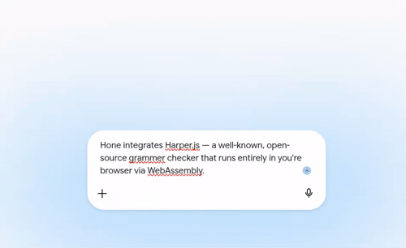
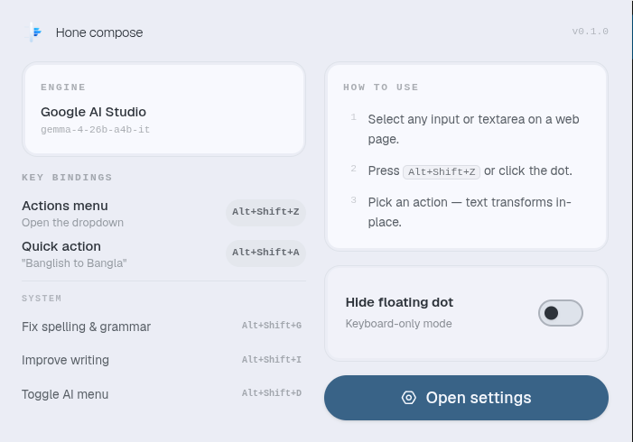
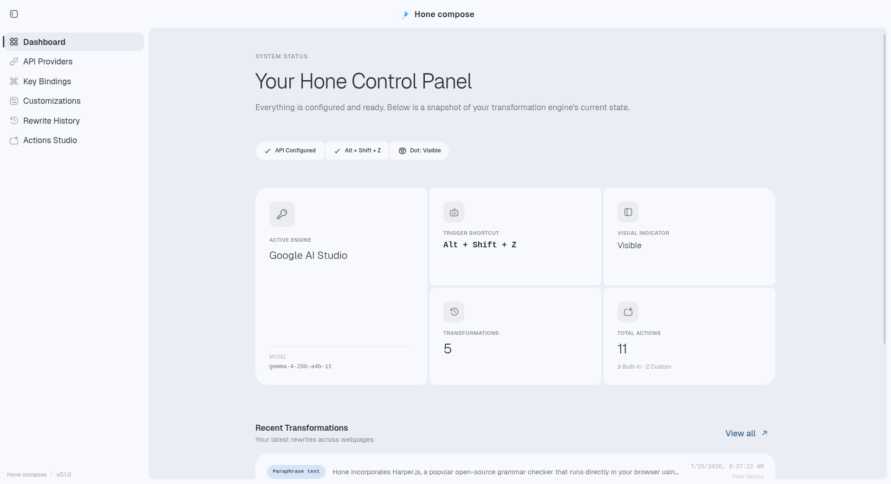
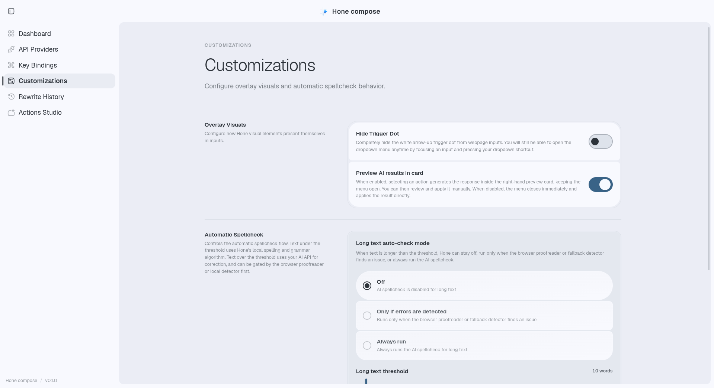
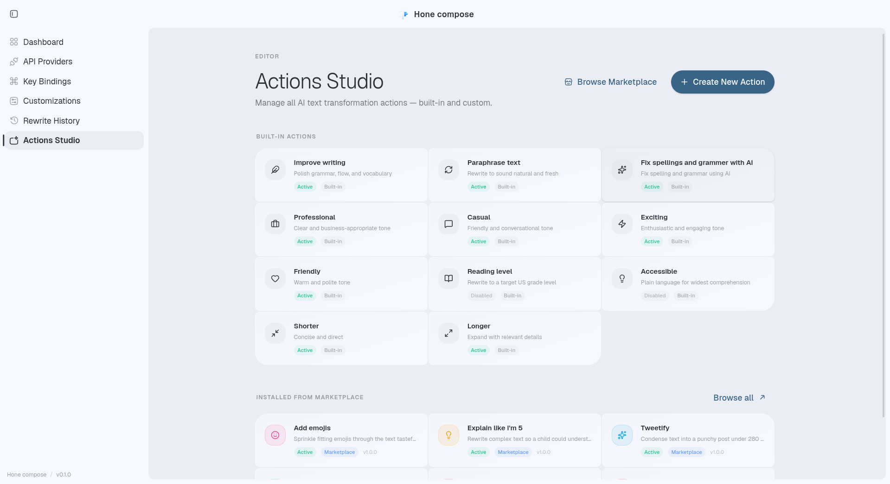

<div align="center">
  

  # Hone compose — AI Writing Assistant for the Web

  [](https://developer.chrome.com/docs/extensions/mv3/intro/)
  [](https://www.typescriptlang.org)
  [](https://react.dev)
  [](https://tailwindcss.com)
  [](https://ui.shadcn.com)
  [](https://www.radix-ui.com)
  [](https://lucide.dev)
  [](https://material-web.dev)
  [](https://deepwiki.com/rabden/hone-compose)

  **Hone is a professional-grade browser extension that brings modern LLM capabilities directly into any text box, editor, or textarea on the web.**
</div>

---

<br>

<table>
<tr>
<td width="33%" align="center">

### 🪄 Improve
Polish grammar, flow, and vocabulary in-place.

</td>
<td width="33%" align="center">

### 🔄 Paraphrase
Rewrite naturally while keeping the original meaning intact.

</td>
<td width="33%" align="center">

### ✅ Fix Spelling
Catch typos, grammar slips, and awkward phrasing instantly.

</td>
</tr>
<tr>
<td width="33%" align="center">

### 👔 Professional
Shift tone to business-appropriate with confidence.

</td>
<td width="33%" align="center">

### 💬 Casual
Make text conversational and easy to read.

</td>
<td width="33%" align="center">

### ⚡ Exciting
Add energy, enthusiasm, and engagement.

</td>
</tr>
<tr>
<td width="33%" align="center">

### ❤️ Friendly
Warm, polite, and approachable phrasing.

</td>
<td width="33%" align="center">

### 🔽 Shorter
Condense rambling text into crisp, direct sentences.

</td>
<td width="33%" align="center">

### 🔼 Longer
Expand brief notes into detailed, thorough prose.

</td>
</tr>
</table>

<p align="center">
  <strong>+ 🛠️ Custom Actions</strong> — the real power of Hone. Build your own AI tools tailored to your workflow. Assign them icons, colors, even per-action models. <em>This is what makes an open-source tool truly open-source — you're not stuck with what we built, you build what you need.</em>
</p>

---

## 🧠 Use Cases

Hone works wherever you type on the web. Here's what it does in plain language:

<dl>
  <dt><strong>📝 Polishing a work email</strong></dt>
  <dd>You draft a reply in Gmail, hit <kbd>Alt+Shift+D</kbd>, pick <em>Improve writing</em>, and Hone rewrites it to sound clear and professional — right inside the compose box.</dd>

  <dt><strong>✍️ Replying on social media</strong></dt>
  <dd>Writing a tweet or a Reddit comment that doesn't quite land? Select the text and ask Hone to make it <em>Casual</em> or <em>Friendly</em> so it reads naturally.</dd>

  <dt><strong>📄 Filling in a job application</strong></dt>
  <dd>You've typed a short answer in a textarea. Hone can <em>Lengthen</em> it to add detail, or shift to <em>Professional</em> tone before you submit.</dd>

  <dt><strong>🐛 Fixing a bug report</strong></dt>
  <dd>You wrote a rough description in GitHub Issues. Use <em>Fix spelling & grammar</em> to clean it up, then <em>Paraphrase</em> so it's clearer for the team.</dd>

  <dt><strong>💬 Chatting on Discord or WhatsApp Web</strong></dt>
  <dd>Hone integrates deeply with Slate.js (Discord) and Lexical (WhatsApp Web) — run actions directly inside rich-text editors without breaking formatting.</dd>

  <dt><strong>🗂️ Drafting a Notion doc or Google Doc</strong></dt>
  <dd>Write freely first, then refine sentence by sentence using any Hone action — no context switching to another tab or tool.</dd>

  <dt><strong>🎨 Creating custom writing tools</strong></dt>
  <dd><em>Actions Studio</em> lets you build your own AI-powered text tools. For example: create a <strong>"Summarize"</strong> action with the prompt <code>Summarize the following text into 3 bullet points: {{input}}</code>, assign it a <em>FileText</em> icon in purple, and bind it to <kbd>Alt+Shift+S</kbd>. It appears in your menu just like a built-in action — except you designed it for exactly what you need.</dd>

  <dt><strong>🔍 Reviewing before committing</strong></dt>
  <dd>Enable <em>Preview before replacing</em> on any action to see a before/after panel before applying changes to your text.</dd>
</dl>

---

## 🔌 API Providers

Hone is provider-agnostic. Bring your own API key — or use the preconfigured free tier.

| Provider | How to use | Pricing |
|---|---|---|
| **OpenRouter** | Get a free API key at [openrouter.ai](https://openrouter.ai) and use any model from their catalog (free or paid). Default provider. | Free models available |
| **OpenAI-compatible** | Bring your own `sk-...` key. Supports custom endpoints (proxies, local gateways). | Your plan |
| **Anthropic** | Paste your `sk-ant-...` key from the Anthropic Console. | Your Anthropic plan |
| **Google AI Studio** | Use a free API key from [aistudio.google.com](https://aistudio.google.com). Generous free tier. | **Free tier available** |
| **Groq** | Fast open models via [console.groq.com](https://console.groq.com). | **Free tier available** |
| **DeepSeek** | Bring your DeepSeek API key. | Pay-as-you-go |

If the active provider fails, Hone can automatically retry the same text with your other configured providers until one succeeds (toggleable in Customizations).

> **No API key? Start with OpenRouter Free** — sign up at openrouter.ai, grab a key, paste it in Hone's settings, and you're good to go. Zero cost.

---

## 🎨 Interactive Flow

```mermaid
graph TD
    User([User]) -->|Focuses text field| Trigger[✨ Hone Trigger Dot]
    Trigger -->|Click / Alt+Shift+D| Menu[Floating Action Menu]
    Menu -->|Select action| Engine[AI Provider Engine]
    Engine -->|Returns result| Preview[Before/After Preview Panel]
    Preview -->|Accept| Replace[Text Replaced In-Place]
    Preview -->|Discard| User

    style User fill:none,stroke:#666,stroke-width:2
    style Trigger fill:#1e1e2e,stroke:#cba6f7,stroke-width:2
    style Menu fill:#1e1e2e,stroke:#cba6f7,stroke-width:2
    style Engine fill:#1e1e2e,stroke:#89b4fa,stroke-width:2
    style Preview fill:#1e1e2e,stroke:#a6e3a1,stroke-width:2
    style Replace fill:#1e1e2e,stroke:#f9e2af,stroke-width:2
```



---

## ✨ Features — Deep Dive

### Text Actions

| Action | What it does |
|---|---|
| **Improve writing** | Enhances grammar, flow, vocabulary — makes any text polished and engaging |
| **Paraphrase** | Rewrites while preserving meaning — fresh wording, natural flow |
| **Fix spelling & grammar** | Corrects errors without changing tone or structure using your AI provider (instant local underlining while you type is handled separately by Harper.js) |
| **Professional tone** | Shifts text to clear, business-appropriate language |
| **Casual tone** | Makes text conversational and easy to read |
| **Exciting tone** | Adds enthusiasm and energy |
| **Friendly tone** | Warms up the phrasing |
| **Shorter** | Condenses text to be direct and concise |
| **Longer** | Expands text with relevant detail and descriptive depth |
| **Custom actions** | User-defined prompts with custom icon, color, provider, model, and temperature |

### 🛠️ Actions Studio — Build Your Own Tools

Hone isn't limited to what we built. The **Actions Studio** is the heart of the project — it lets anyone create custom AI-powered text tools without writing code. You define the prompt, pick an icon and color, and it sits in your menu alongside the built-in actions. **That's the point: an open-source tool that you shape to fit your workflow, not the other way around.**

**Example — a "Summarize" tool:**
1. Click **Create New Action** in Actions Studio
2. Name it `Summarize`
3. Set the prompt template to: `Summarize this into 3 concise bullet points:\n\n{{input}}`
4. Pick the `FileText` icon, set color to purple
5. Optionally assign it to a specific provider/model
6. Save — it's now in your action menu on any website

**Everything you can configure:**
- **Prompt templates** with `{{input}}` variable — the selected text gets injected at rewrite time
- **System prompts** — set context/role instructions for the AI
- **Icon picker** — choose from 100+ Lucide icons to identify your action
- **Accent color** — pick from 8 preset colors for visual distinction
- **Per-action provider** — override the global provider for a specific action
- **Per-action model** — target a specific model for this action only
- **Temperature slider** — control creativity (0.0 = deterministic, 2.0 = max creativity)
- **Preview mode** — toggle before/after review panel instead of inline replacement
- **Enable/disable** — turn actions on/off without deleting them
- **Test playground** — run your action against sample text directly in the options page

### 🏪 Action Marketplace

Hone includes a built-in **Action Marketplace** for discovering and installing community-built actions — no coding required.

- **Browse & search** actions by name, description, or tags from the marketplace panel in Actions Studio
- **One-click install** — actions are fetched from the public registry and instantly available in your action menu
- **Automatic updates** — if an installed action has a newer version, an "Update" badge appears with a single-click update
- **Per-action management** — enable/disable, uninstall, or update marketplace actions individually
- **Open registry** — the [Hone Actions Registry](https://github.com/rabden/Hone-Actions-Registry) is a public GitHub repo. Anyone can contribute actions via pull request. See [architecture.md](architecture.md#marketplace-registry) for the full registry schema and contribution guide.

Marketplace actions use the same `CustomAction` storage model as user-created actions, distinguished by type. Provider, model, and temperature are user-configurable per action after installation.

### Smart Text Boundary Inference

When no text is selected, Hone targets the whole field; highlight text and it rewrites exactly that:

1. **Selection** — explicitly highlighted text (highest priority)
2. **Full field** — entire editor contents (default when nothing is selected)

Sentence- and paragraph-level inference live in the engine (`computeInferenceOptions`), ready to be surfaced in the menu.

### ⚡ Live Spelling & Grammar with Harper.js

Hone integrates **Harper.js** — a well-known, open-source grammar checker that runs entirely in your browser via WebAssembly. As you type, misspelled words and grammar slips are underlined right in the field (red for spelling, blue for grammar), and hovering — or clicking — an underline opens a small card with every fix Harper suggests. Apply one, add the word to your personal dictionary, or ignore it for good. Nothing is sent to any server, and your dictionary and ignores persist across sessions.

**Why Harper.js?**
- **Privacy-First**: All grammar checking happens locally in your browser. Your text never leaves your device for spelling/grammar analysis.
- **Live, not batch**: checking runs a moment after you stop typing, so underlines stay current without ever blocking your keystrokes.
- **No API Costs**: Unlike cloud-based grammar services, Harper.js is free to use with no rate limits or subscription fees.
- **Offline Capable**: Works without an internet connection once the WASM module is loaded.
- **SEO-Friendly**: Harper is a widely recognized name in the developer community, making Hone more discoverable for users searching for grammar checking solutions.

**How it works:**
1. About half a second after you stop typing, Hone checks if the text is primarily English using Chrome's language detection API.
2. Harper.js runs locally as a WebAssembly module, analyzing your text for spelling errors, grammar mistakes, and awkward phrasing.
3. Each flagged span is underlined — natively on rich editors via the CSS Custom Highlight API, and as wavy overlays on inputs and textareas.
4. Hovering (or clicking) an underline opens an anchored suggestion card; applying a fix goes through the same transaction engine as AI rewrites, so every editor framework (Slate, Lexical, ProseMirror, Draft.js) records it as a real edit. "Add to dictionary" and "Ignore" are remembered permanently — locally, in your browser.
5. Smart fallback skips underlining if too many errors are detected (indicating non-English text or gibberish).

**Performance:**
- WASM-based execution for near-native speed, with results cached per text so re-focusing a field is instant
- Language detection prevents unnecessary processing on non-English text
- Smart error threshold avoids false positives on code snippets or technical content

### 🔐 Privacy Guard: Secret Fields Are Off-Limits

Hone never activates on password, payment, or one-time-code fields. The trigger dot, floating menu, and keyboard shortcuts are fully disabled on any input that looks like a secret (including text inputs labeled `current-password`, `cc-number`, `one-time-code`, or similar) — so your secrets can never be captured or sent to any AI provider.

### Rich-Text Editor Compatibility

| Editor | Integration method |
|---|---|
| **Slate.js** (Discord) | React Fiber traversal, direct `editor.insertText()` call |
| **Lexical** (Facebook, WhatsApp Web) | `beforeinput` event with `insertReplacementText` |
| **ProseMirror** | Contenteditable-based DOM manipulation |
| **Twitter/X** | Custom editor adapter |
| **Native inputs** | `<input>`, `<textarea>` — via `execCommand` and value tracker |
| **Generic contenteditable** | Fallback DOM range manipulation |

### Keyboard Shortcuts

- **Menu toggle** — configurable combo (default: `Alt+Shift+D`) to open/close the floating action menu
- **Quick action** — configurable combo to run a specific action instantly without opening the menu
- **System commands** — manifest-level shortcuts that work even when websites intercept keystrokes
- **Shortcut recorder** — press any key combination to capture it in settings

### Configuration & Dashboard

The Options page gives you full control:

- **Dashboard** — at-a-glance status: API connection, active shortcuts, total rewrites, recent activity
- **API Providers** — manage keys, models, and endpoints for all providers
- **Key Bindings** — record custom shortcuts, hide the floating dot (keyboard-only mode)
- **Customizations** — overlay visuals, live proofreading toggle, provider fallback, history limit
- **Rewrite History** — searchable, virtual-scrolled log with before/after detail view, copy, and delete
- **Actions Studio** — create, edit, and test custom actions

### UI Highlights

- **Modern shadcn/ui components** — built on Radix primitives for accessible, composable UI patterns
- **Material Web Components** — Google's Material Design 3 web components for dialogs, menus, switches, and buttons
- **Shadow DOM isolation** — page CSS can't leak into Hone's interface
- **Floating UI** — menu and preview panels follow the text caret automatically (flip, shift, collision detection)
- **Glassmorphic MD3 design** — Material Design 3 tokens with frosted-glass surfaces
- **Spring physics** — `cubic-bezier(0.175, 0.885, 0.32, 1.275)` for natural, bouncy micro-interactions
- **Web Audio API haptics** — buttons and switches produce tactile audio feedback
- **Trigger dot** — purple sparkle icon that appears when you focus any text field (toggleable)

---



<br>

## 📸 Showcase

<table>
  <tr>
    <td width="50%" align="center">
      
      <br><br>
      <strong>Extension Popup</strong><br>
      <span style="font-size:13px;color:#888;">Active engine, shortcuts & quick settings</span>
    </td>
    <td width="50%" align="center">
      
      <br><br>
      <strong>Options Dashboard</strong><br>
      <span style="font-size:13px;color:#888;">Status overview, metrics & recent activity</span>
    </td>
  </tr>
  <tr>
    <td width="50%" align="center">
      
      <br><br>
      <strong>Customize Settings</strong><br>
      <span style="font-size:13px;color:#888;">Tailor providers, key bindings, and default behaviors to your workflow</span>
    </td>
    <td width="50%" align="center">
      
      <br><br>
      <strong>Actions Studio</strong><br>
      <span style="font-size:13px;color:#888;">Build your own writing tools</span>
    </td>
  </tr>
</table>

<br>

---

## 🚀 Quick Start

### 🖥️ For Developers

```bash
git clone https://github.com/rabden/hone-compose.git
cd hone-compose
npm install
npm run build
```

Outputs to `dist/`.

### 📦 For Everyone Else

[](https://github.com/rabden/hone-compose/releases/latest)

1. **Download** `hone-v0.0.1.zip` from the [latest release](https://github.com/rabden/hone-compose/releases/latest)
2. **Extract** the zip somewhere on your computer
3. Open Chrome and go to `chrome://extensions/`
4. Enable **Developer mode** (toggle in the top-right corner)
5. Click **Load unpacked** (top-left)
6. Select the extracted `hone-v0.0.1/` folder

That's it — Hone is now installed.

### 🔑 Add an API key

- Click the Hone icon in the toolbar, then **Open settings**
- Go to **API Providers**, pick your provider, paste your key
- No key yet? Grab a free one from [openrouter.ai](https://openrouter.ai) (the default provider) or [console.groq.com](https://console.groq.com)

> **Tip:** spelling and grammar underlining works without any API key — it runs locally via Harper.js.

### ✍️ Use it

Focus any text input on any webpage. Press `Alt+Shift+D` (default) or click the purple sparkle dot. Pick an action — your text transforms in-place.

---

## 📚 Technical Architecture

| Component | What it does |
|---|---|
| **Content Script** | Injected into every page. Renders the menu/preview UI in a Shadow DOM. Detects editor frameworks (Slate, Lexical, etc.) and adapts accordingly. |
| **Background Worker** | Routes AI requests to the configured provider. Handles OpenRouter Free model fallback cycling. Saves rewrite history. |
| **Main World Bridge** | Runs in the page's main JavaScript context. Traverses React Fiber trees to invoke editor event handlers that are inaccessible from the isolated world. |
| **Floating UI** | `@floating-ui/dom` for auto-positioning relative to the text caret (flip, shift, collision detection). |
| **Transaction Engine** | Low-level framework-specific commit logic — React Fiber walking, `beforeinput` events, `execCommand` — to inject rewritten text without breaking the host editor's state. |

> [!NOTE]
> For a deep dive into React Fiber traversal, editor adapter architecture, and file-by-file breakdown, see [architecture.md](architecture.md).

---

## 📄 License

This project is licensed under the MIT License. See [LICENSE](LICENSE) for details.
