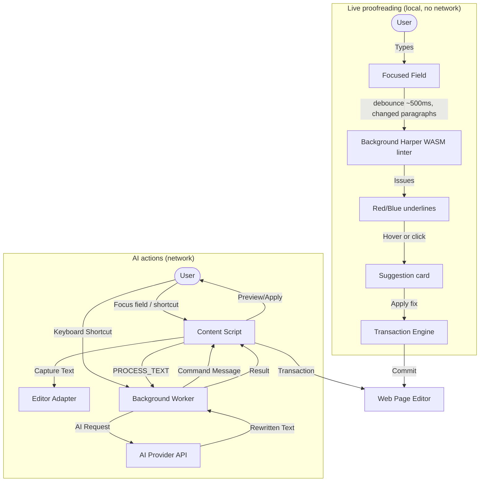

# Hone — Technical & Architecture Details

This document contains the low-level architectural details, file tree structure, framework interaction logic, and developer guides for the Hone AI Writing Assistant browser extension.

---

## System Flow



---

## Architecture Design

The project is structured into three main execution environments, coordinated via Chrome's messaging system and shared storage:

### 1. Content Script (`src/content/`)
Injected into every webpage. It handles UI rendering, user interaction, and editor manipulation.
- **Shadow DOM Isolation**: The UI is encapsulated in a Shadow Root to prevent style leaks. Entry: [index.tsx](file:///disk2/desktop/extensions-A/src/content/index.tsx), UI: [app.tsx](file:///disk2/desktop/extensions-A/src/content/app.tsx).
- **Adapter Pattern**: Abstracted interface for different editor types. See [adapters.ts](file:///disk2/desktop/extensions-A/src/content/adapters.ts).
- **Transaction Engine**: Sophisticated logic to inject text into rich-text editors (Slate, Lexical, etc.) without breaking their internal state — insertions and deletions. See [transaction-engine.ts](file:///disk2/desktop/extensions-A/src/content/transaction-engine.ts).
- **Live Proofreading**: Debounced Harper.js linting with underlines and hover/click fix cards. See [live-proofread.ts](file:///disk2/desktop/extensions-A/src/content/live-proofread.ts).
- **Positioning**: Calculates floating UI placement relative to the text caret using Floating UI. See [positioning.ts](file:///disk2/desktop/extensions-A/src/content/positioning.ts).
- **Word-Level Diff**: LCS-based diffing algorithm for visualizing text changes. See [word-diff.ts](file:///disk2/desktop/extensions-A/src/content/word-diff.ts).
- **Rich Editor Orchestration**: High-level replacement logic that delegates to transaction-engine. See [rich-editor-replace.ts](file:///disk2/desktop/extensions-A/src/content/rich-editor-replace.ts).

### 2. Background Service Worker (`src/background/`)
The extension's central nervous system.
- **AI Orchestration**: Routes prompts to OpenRouter, OpenAI-compatible endpoints, Anthropic, Google AI Studio, Groq, or DeepSeek via the Vercel AI SDK. See [service-worker.ts](file:///disk2/desktop/extensions-A/src/background/service-worker.ts).
- **Smart Provider Fallback**: If the active provider fails, retries the same text with the user's other configured providers in order until one succeeds (user-opt-out via `enableProviderFallback`). Per-action `provider`/`model`/`temperature` fields are stored on actions but are **not currently read at runtime** — the global provider/model setting and a fixed temperature (0.7) are used for every request.
- **Off-page Proofreading**: Serves every `LINT_TEXT` / `WARMUP_LINTER` request in the service worker, keeping synchronous Harper WASM work off the page's UI thread and independent of page CSP. One queue serializes linting, startup and dictionary/ignore updates (`PROOFREAD_STATE_ADDED`); the background is the sole state writer. Cold-start linter setup retries once — the wasm fetch can reject transiently while the service worker is starting — and a failed warmup is only logged as a warning because the next check re-initializes.
- **Global Commands**: Listens for the manifest-defined keyboard shortcuts (`toggle-menu` Alt+Shift+D, `improve-writing` Alt+Shift+I, `fix-spelling` Alt+Shift+G, `paraphrase` Alt+Shift+P) and relays them to the active tab as `COMMAND_TRIGGERED`.
- **Response Sanitization**: Strips raw tag leakage (e.g. `</assistant>`, `</thought>`) from model output before saving history or returning to the content script.
- **Marketplace**: Fetches and caches the public Actions Registry (6h TTL) and installs/validates individual action JSONs. See the [Marketplace Registry](#marketplace-registry) section.
- **Sender Verification**: All runtime messages must come from the extension itself (`sender.id` check); marketplace messages additionally require an extension-page sender.

### 3. Extension Pages (`src/popup/` & `src/options/`)
- **Popup**: Active provider/model picker with key-status dots, live shortcut bindings, the two most recent rewrites (copy + deep-link into history), and quick toggles for the trigger dot, AI preview card, and live proofreading. Entry: [main.tsx](file:///disk2/desktop/extensions-A/src/popup/main.tsx), UI: [popup.tsx](file:///disk2/desktop/extensions-A/src/popup/popup.tsx).
- **Options**: Six tabs — Dashboard, API Providers, Key Bindings, Customizations (overlay visuals, live proofreading, provider fallback, history limit), Rewrite History, and Actions Studio (create/edit/test + marketplace). Entry: [main.tsx](file:///disk2/desktop/extensions-A/src/options/main.tsx), UI: [options.tsx](file:///disk2/desktop/extensions-A/src/options/options.tsx).

---

## Key Technical Deep-Dives

### **Editor Interaction (The "Nooks and Crannies")**
Interacting with web editors is the project's biggest challenge. Hone uses a tiered approach:
1. **Framework Detection**: [editor-detection.ts](file:///disk2/desktop/extensions-A/src/content/editor-detection.ts) fingerprints the element (native, Lexical, Slate, ProseMirror, Draft.js, Twitter/X, generic `contenteditable`), and [adapters.ts](file:///disk2/desktop/extensions-A/src/content/adapters.ts) wraps it in the right `EditableAdapter` (sensitive fields are refused entirely, see [sensitive-fields.ts](file:///disk2/desktop/extensions-A/src/content/sensitive-fields.ts)).
2. **React Fiber Traversal**: To support editors like Discord (Slate) and Twitter/X, Hone traverses the React Fiber tree (`__reactFiber$`) in the page context (Main World) to find the internal `editor` instance or trigger event handler props (`onChange`, `onChangeText`, `onInput`) directly. See [main-world-bridge.ts](file:///disk2/desktop/extensions-A/src/content/main-world-bridge.ts) and [transaction-engine.ts](file:///disk2/desktop/extensions-A/src/content/transaction-engine.ts).
3. **Event Simulation**: Insertions use `beforeinput` with `insertReplacementText` or simulated `paste` events so editors record the change in their undo/redo history. Deletions (empty replacement, e.g. "Remove the space") use `execCommand("delete")` — `insertText` with an empty string is a guaranteed no-op in Chrome — with a `deleteByCut` beforeinput fallback.
4. **Canonical Text and Snapshotting**: [plain-text-dom.ts](file:///disk2/desktop/extensions-A/src/content/plain-text-dom.ts) maps text, DOM points, selections and highlights through the same newline-aware model: one LF per block boundary or meaningful `<br>`, preserving empty paragraphs and ignoring caret-placeholder BRs. It avoids `Range.toString()` (which drops structural newlines) and `innerText` (which adds layout-dependent spacing). Replacement targets are resolved against current text using their original snapshot; missing, edited or ambiguous spans fail rather than replacing an unrelated occurrence.
5. **Verification**: Commits must produce the exact canonical text splice and an actual change. Whitespace normalization and prefix probes cannot stand in for success, so lost newlines, no-op deletions and partial writes fail. Changed-but-unverified attempts stop the strategy chain. Bridge requests are correlated, snapshots are revalidated before mutation, and native fields prefer undo-preserving editing commands over setter fallbacks.

### **Advanced UI Components**
The project includes high-fidelity custom components designed for a native-like feel:
- **Haptic Feedback**: Custom components like `MaterialDesign3Button` and `MaterialDesign3Switch` include a **Web Audio API** based haptic engine that generates "tactile pop" sounds and vibration-like audio cues.
- **Physics-based Animations**: Custom ripple hooks and spring-based easing (`cubic-bezier(0.175, 0.885, 0.32, 1.275)`) provide high-quality interaction feedback.
- **2-Column Menu Layout**: The floating action menu uses a split design with actions on the left and a preview card on the right, allowing users to review AI results before applying. See [floating-action-menu.tsx](file:///disk2/desktop/extensions-A/src/content/floating-action-menu.tsx).
- **Dynamic Sizing**: The preview card matches the action column's height, observed live via a `ResizeObserver`, and widens to card-only mode when an AI result or confirm state owns the UI.

### **Live Proofreading with Harper.js (QuillBot-style)**
Hone integrates Harper.js (a well-known open-source grammar checker) for instant, offline spelling and grammar correction **while you type**:
- **WASM Module**: Harper.js runs only in the extension service worker ([background/grammar-worker.ts](file:///disk2/desktop/extensions-A/src/background/grammar-worker.ts)). The content [grammar-worker.ts](file:///disk2/desktop/extensions-A/src/content/grammar-worker.ts) is a messaging client: no page-thread WASM compilation, linting, or CSP fallback race. Harper 2.0.0 already reports UTF-16 offsets, including after emoji; the pipeline does not convert them a second time.
- **Issues, not corrections**: Harper's lints are converted to positioned issues with labeled fixes ([proofread-issues.ts](file:///disk2/desktop/extensions-A/src/content/proofread-issues.ts), modeled on markview's `spell::harper_issues`: spelling lints win overlaps, suggestions map to Replace/InsertAfter/Remove fixes, Markdown is stripped from messages).
- **Debounced paragraph loop**: [proofread-scheduler.ts](file:///disk2/desktop/extensions-A/src/content/proofread-scheduler.ts) owns the 500ms trailing debounce independently of card timers. Input, IME composition, state changes and teardown invalidate pending results immediately; at most one lint request is outstanding per controller. Newline-delimited paragraphs retain cached relative issues, which shift with their paragraph when preceding text changes. Only changed/uncached paragraphs are linted, and the final non-whitespace token is excluded until a space, tab or newline completes it. While a changed paragraph awaits its lint, its previously painted issues are carried across the edit via a common prefix/suffix diff (`rebaseIssues`): spans untouched by the edit keep their underlines (shifted when text before them changed), and only spans overlapping the edit drop — so highlights never blink out mid-typing. The 8,000-character limit applies per paragraph, not to the whole field; oversized paragraphs do not disable other paragraphs. [live-proofread.ts](file:///disk2/desktop/extensions-A/src/content/live-proofread.ts) owns DOM events, painting, cards and fixes.
- **Underlines**: contenteditable spans use the **CSS Custom Highlight API** with a single DOM-text map per paint; `input`/`textarea` get wavy overlay strips using one mirror write followed by batched range reads in `span-geometry.ts`, rather than rewriting and laying out the mirror for every error. While a field is being proofread, the controller sets `spellcheck="false"` on it (native spellcheck is element-scoped and cannot be exempted per word) and restores the field's original attribute on stop, so the browser's own red squiggle never doubles up with Hone's. Input/scroll/resize invalidate geometry; issues overlapping an edit disappear immediately while all other spans stay painted with correctly rebased offsets. Red = spelling, blue = grammar (Google Docs/Word convention).
- **Suggestion cards** ([suggestion-card.tsx](file:///disk2/desktop/extensions-A/src/content/suggestion-card.tsx)): hovering ~160ms over an underlined issue — or **clicking** it (click again to dismiss) — opens a floating-ui-anchored, options-only card: every Harper fix (click applies it through the full `replaceRange` transaction engine), plus "Add to dictionary" (spelling) and "Ignore". A window-level close arbiter keeps the card open only while the pointer is over the card or the field — geometry-based, since events leaving the shadow root are retargeted to the host.
- **Persistent personal dictionary & ignores** ([proofread-dictionary.ts](file:///disk2/desktop/extensions-A/src/content/proofread-dictionary.ts) + [harper-lint.ts](file:///disk2/desktop/extensions-A/src/content/harper-lint.ts)): "Add to dictionary" feeds Harper's own dictionary (`importWords`), and Ignore stores Harper's stable `contextHash`. The background queue persists these in `chrome.storage.local` before acknowledging the request and applies them before subsequent linting. Content scripts observe storage changes even while no field is focused, invalidate paragraph caches and refresh active controllers. Failed writes/imports are not reported as successful; failed lint responses are not cached as clean text.
- **Language Detection**: Uses Chrome's `chrome.i18n.detectLanguage` API. Reliable non-English skips linting; reliable English outranks the spelling-density fallback. A language-agnostic backstop applies regardless of detection: if 5+ consecutive words in a paragraph are all misspelled (`hasConsecutiveSpellingErrors`), the text is not English prose — romanized Banglish/Hinglish/Urdu and other transliterations flag word after word, while correct English function words always break a typo run — so all issues for that paragraph are suppressed. The density guard (≥6 words, >60% flagged) remains only for uncertain detection.
- **Privacy-First**: All processing happens locally in the browser — no text is sent to external servers for grammar checking. The `liveProofread` setting lives in the popup and the Customizations tab.

### **Word-Level Diff Visualization**
The [word-diff.ts](file:///disk2/desktop/extensions-A/src/content/word-diff.ts) module implements a Longest Common Subsequence (LCS) algorithm for computing word-level differences:
- **Tokenization**: Groups words with trailing whitespace to preserve formatting during diffing.
- **LCS Algorithm**: Dynamic programming approach to find the longest common subsequence between original and rewritten text.
- **Performance Fallback**: For very large texts (>800 tokens on either side), falls back to a coarse whole-text remove/add pair to avoid O(N²) time and memory.
- **Token Merging**: Consecutive tokens of the same type (add/remove) are merged for cleaner presentation.
- **Alternating Collapse**: Alternating add/remove runs are collapsed into single replacement blocks for intuitive diff display.

### **Inference Level System**
When an action runs, the rewrite target is resolved by `resolveReplacementSpan` ([adapters.ts](file:///disk2/desktop/extensions-A/src/content/adapters.ts)):
- **Selection**: Explicitly highlighted text (highest priority)
- **Full Field**: Entire editor contents (default when nothing is selected)

`computeInferenceOptions` also computes **sentence** (regex boundaries) and **paragraph** (blank-line blocks) spans, but no in-menu scope switcher is currently wired — `selectedInferenceLevel` always resolves to the best option (selection if present, otherwise the whole field).

---

## Detailed File Tree & Responsibilities

```text
src/
├── background/
│   ├── grammar-worker.ts      # [Logic] Sole Harper linter: serialized off-page checks and state writes.
│   └── service-worker.ts      # [Core] AI provider routing + smart fallback, grammar/marketplace messages,
│                              #       manifest commands, response sanitization, history saving, sender checks.
├── components/
│   ├── ui/                    # [UI] Radix-based primitives and custom MD3 components.
│   │   ├── badge.tsx          # Unified badge component with variant support.
│   │   ├── button.tsx         # Base Radix-slot button with Tailwind variants.
│   │   ├── card.tsx           # Compound components for structured panels (Title, Description, Content, Footer).
│   │   ├── dotm-square-12.tsx # 12px dot-matrix loading square (Dotm protocol).
│   │   ├── expanding-search-dock.tsx # Expanding search field used by the options pages.
│   │   ├── hugeicons.tsx      # Hugeicons react wrapper component.
│   │   ├── input.tsx          # Styled HTML input with focus ring and invalid state handling.
│   │   ├── label.tsx          # Accessible Radix label primitive.
│   │   ├── material-design-3-button.tsx # Custom button with Web Audio haptics and ripple physics.
│   │   ├── material-design-3-switch.tsx # Custom switch with audio feedback and spring animations.
│   │   ├── material-dialog.tsx # Styled accessible dialog box primitive utilizing Radix Dialog.
│   │   ├── menu.tsx           # Accessible cascading menu UI using Radix Dropdown Menu.
│   │   ├── modern-dropdown.tsx # Custom dropdown list overlay with keyboard selection logic.
│   │   ├── radio-card.tsx     # Radio-card group used for exclusive choice rows.
│   │   ├── ripple.tsx         # Styled micro-animation background element for touch/click ripple effects.
│   │   ├── scroll-area.tsx    # Styled scrollbar wrapper with hide-on-idle styling.
│   │   ├── select.tsx         # Complex Radix select with viewport scrolling and portal support.
│   │   ├── separator.tsx      # Accessible decorative separator.
│   │   ├── sheet.tsx          # Slide-out panel element for side options drawer (Radix Dialog).
│   │   ├── sidebar.tsx        # Accessible sidebar navigation shell with Collapsible states.
│   │   ├── skeleton.tsx       # Loading state placeholder block element.
│   │   ├── switch-card.tsx    # Grouped setting cards with MD3 switches and positional rounding.
│   │   ├── switch.tsx         # Base Radix switch primitive.
│   │   ├── tabs.tsx           # Multi-variant Radix tabs (default and line styles).
│   │   ├── tag.tsx            # Interactive tag/pill element (ripple + selected states).
│   │   ├── textarea.tsx       # Auto-sizing textarea with integrated focus styling.
│   │   └── tooltip.tsx        # Radix-based hover tooltip element for auxiliary labels.
│   ├── action-icon-select.tsx # [UI] Custom accessible icon picker with keyboard navigation.
│   ├── history-list.tsx       # [UI] Virtualized rewrite history rows with press morphing and copy.
│   ├── hone-logo.tsx          # [UI] SVG brand asset with sizing props.
│   └── material-registry.tsx  # [Logic] Client-side dynamic imports for registering Material Web Components.
├── content/
│   ├── actions.ts             # [Logic] ActionRegistry class. Manages built-in/custom/marketplace prompts & icons.
│   ├── adapters.ts            # [Logic] EditableAdapter interface & implementations (Native Input, ContentEditable,
│   │                          #       Slate, Lexical, ProseMirror, Twitter, Draft.js). React valueTracker resets,
│   │                          #       span re-location, inference options, active-context resolution.
│   ├── api.ts                 # [Utility] Robust fetch wrapper with AbortSignal, timeouts, and streaming support.
│   ├── app.tsx                # [Main] Root React component for the injected UI. Menu/preview/live-proofreading state,
│   │                          #       focus tracking, keyboard interception, suggestion-card + squiggle rendering.
│   ├── builtin-defaults.ts    # [Data] Built-in action definitions (prompts, icons, categories, enabled flags).
│   ├── confirm-dialog.tsx     # [Stub] Reserved for confirm dialog extraction.
│   ├── content.css            # [Styles] Scoped styles for the Shadow DOM container (incl. squiggle underlines).
│   ├── editor-detection.ts    # [Logic] Framework fingerprinting and editor-root resolution (incl. X compose).
│   ├── floating-action-menu.tsx # [UI] 2-column floating menu with action list, accordions and preview card.
│   ├── grammar-worker.ts      # [Logic] Background lint/state messaging client and storage-change subscription.
│   ├── harper-lint.ts         # [Logic] Background lint pipeline: context hashes, persistent-ignore filtering, conversion.
│   ├── highlight-shimmer.tsx  # [UI] Loading shimmer overlay for the AI-processing span.
│   ├── index.tsx              # [Entry] Mounts the React app into a Shadow Root,
│   │                          #       warms the WASM linter on first field focus.
│   ├── keyboard-guard.ts      # [Utility] Activation-key detection/suppression so menu keys never reach the field.
│   ├── live-proofread.ts      # [Logic] Live proofreading controller: debounced lint loop, CSS Highlight underlines,
│   │                          #       hover/click hit-testing and cards, fix application, dictionary/ignore actions.
│   ├── main-world-bridge.ts   # [Bridge] Main-world script: Slate/Lexical/Twitter/React-input transactions,
│   │                          #       registered as a static MAIN-world content script in manifest.json
│   │                          #       (no script-tag/URL injection), reached via window.postMessage.
│   ├── overlay-chrome.tsx     # [UI] TriggerDot (field-corner chevron) and overlay toast.
│   ├── plain-text-dom.ts      # [Logic] Newline-aware canonical text/DOM map shared by both execution worlds.
│   ├── positioning.ts         # [UI] Floating-UI integration (flip/shift/autoUpdate) for menu and cards.
│   ├── preview-panel.tsx      # [Stub] Reserved for preview panel extraction.
│   ├── preview-types.ts       # [Stub] Reserved for preview type extraction.
│   ├── proofread-dictionary.ts # [Data] Persistent personal dictionary + ignored lint hashes (chrome.storage).
│   ├── proofread-issues.ts    # [Logic] Pure Harper lint → issue conversion (spelling-first overlap dedupe,
│   │                          #        labeled fixes, plain messages, ignore keys, non-English guard).
│   ├── proofread-scheduler.ts # [Logic] Debounce, paragraph cache/rebasing, incomplete-token exclusion, cancellation.
│   ├── rich-editor-replace.ts # [Logic] High-level replacement orchestration: span re-location → transaction engine.
│   ├── sensitive-fields.ts    # [Security] Password/payment/OTP field detection — never adapted, never captured.
│   ├── span-geometry.ts       # [Logic] Mirror-based measurement of character spans → viewport rects.
│   ├── storage.ts             # [Data] Config keys, action configs (chrome.storage) and History (IndexedDB).
│   ├── suggestion-card.tsx    # [UI] Hover-anchored card: fix options, Add-to-dictionary, Ignore.
│   ├── target-highlight.tsx   # [UI] Renders the active AI target span (idle marker or loading shimmer).
│   ├── target-text-highlight.ts # [Logic] Target-span painting: CSS Highlight API + native ::selection styling.
│   ├── transaction-engine.ts  # [Logic] Low-level framework commits (Main-World Slate/Lexical/Twitter bridges,
│   │                          #        beforeinput, deleteByCut deletions, execCommand, paste) with verification.
│   ├── transaction-text.ts    # [Logic] Pure snapshot relocation and exact, newline-sensitive verification.
│   └── word-diff.ts           # [Logic] Word-level LCS diff algorithm for visualizing text changes.
├── hooks/
│   └── use-mobile.ts          # [Utility] Responsive breakpoint hooks targeting mobile layouts.
├── lib/
│   ├── action-icons.tsx       # [UI] Dynamic Lucide icon renderer for actions.
│   ├── dotmatrix-core/        # [UI] Dot-matrix loading primitives (components, factories, utils).
│   ├── dotmatrix-hooks.ts     # [UI] React hooks driving the dot-matrix loaders.
│   ├── shortcuts.ts           # [Utility] Formatting, labeling, and default action names for shortcuts.
│   └── utils.ts               # [Utility] cn() helper using tailwind-merge and clsx.
├── onboarding/                # [Page] First-run onboarding (opened on install).
│   ├── main.tsx               # Entry point.
│   └── onboarding.tsx         # Onboarding flow UI.
├── options/                   # [Page] Extension settings page (React).
│   ├── main.tsx               # Entry point for the options page.
│   ├── options.tsx            # Shell: sidebar tabs, settings load/save, history deep-links.
│   └── tabs/
│       ├── ActionsStudioTab.tsx   # Actions Studio container (overview / editor / marketplace views).
│       ├── actionstudio/      # Studio internals: card grid, editor (prompt/icon/model fields),
│       │                      # marketplace browse+install+update, constants, types.
│       ├── ApiProvidersTab.tsx    # Provider keys, models, endpoints for all six providers.
│       ├── CustomizationsTab.tsx  # Overlay visuals, live proofreading toggle, provider fallback, history limit.
│       ├── DashboardTab.tsx       # Status overview: connection, shortcuts, rewrite stats, recent activity.
│       ├── HistoryTab.tsx         # Searchable rewrite history with detail dialog.
│       └── KeyBindingsTab.tsx     # Shortcut recorder for menu toggle + quick action.
├── popup/                     # [Page] Extension popup menu (React).
│   ├── main.tsx               # Entry point for the popup.
│   └── popup.tsx              # Provider picker, shortcuts, two latest rewrites, quick toggles.
├── providers.ts               # [Data] Provider registry: ids, labels, storage keys, defaults, configured checks.
├── types/
│   └── material-web.d.ts      # TypeScript definitions for Material Web Components.
├── App.css                    # Vite template styles.
├── App.tsx                    # [Dev] Vite template landing page (not in production bundle).
├── index.css                  # Global Tailwind imports and base styles.
└── main.tsx                   # [Dev] Entry point for the Vite development landing page.

tests/
├── proofread-issues.test.ts    # Harper lint → issue conversion rules (overlaps, fix labels, ignore keys).
├── proofread-scheduler.test.ts # Debounce, IME, stale responses, paragraph caching and unfinished tokens.
├── plain-text-dom.test.ts     # Canonical newlines and round-trip DOM/UTF-16 offsets.
├── transaction-text.test.ts   # Snapshot relocation, no-ops, partial writes and newline-sensitive verification.
├── background-grammar-worker.test.ts # Serialized state/checks, failure propagation and real Harper UTF-16 spans.
├── content-grammar-worker.test.ts    # Off-page messaging and storage-change subscription.
├── proofread-dictionary.test.ts      # Persistence failure and dictionary/ignore bounds.
├── editor-browser.html       # Vite browser fixture with real controller/card/adapters and simulated extension APIs.
├── editor-browser.tsx        # Interactive native, React-controlled and contenteditable fixtures.
├── proofread-browser-worker.ts # Runs real background Harper logic off-page for the browser fixture.
└── sensitive-fields.test.ts   # Secret-field detection contract: passwords/payment/OTP never adapted.
```

---

## Marketplace Registry

The Hone Actions Registry is a public GitHub repo that acts as a curated catalog of community-contributed actions. All installed marketplace actions are fetched directly from this repo (not bundled with the extension).

### Repo Location
- **URL**: `github.com/rabden/Hone-Actions-Registry`
- **Base raw URL**: `https://raw.githubusercontent.com/rabden/Hone-Actions-Registry/main/`

### Registry Files

| File | Purpose |
|---|---|
| `registry.json` | Index of all available actions (id, name, icon, color, path, tags) |
| `schema.json` | JSON Schema that validates individual action JSON files |
| `actions/*.json` | Individual action definitions (one file per action) |
| `scripts/validate.js` | CI validation script |
| `CONTRIBUTING.md` | Contribution guidelines |

### `registry.json` Structure

The registry is an index. Each entry is:

```ts
interface RegistryAction {
  id: string;        // e.g. "mkt_action_items"
  name: string;      // Display name
  description: string;
  icon: string;      // Lucide icon name (PascalCase, e.g. "ListChecks")
  color: string;     // Hex color for the icon
  version: string;   // Semver
  author: string;    // GitHub username or team
  tags: string[];    // Lowercase kebab-case tags
  path: string;      // Relative path to action JSON, e.g. "actions/action-items.json"
}
```

### Action JSON File Fields

Each `actions/*.json` file is validated against `schema.json` and contains:

```ts
{
  id: "mkt_<name>",        // Pattern: ^mkt_[a-z0-9_]+$, max 64 chars
  name: string,            // 3-80 chars
  description: string,     // 10-160 chars
  icon: string,            // PascalCase Lucide name
  color: string,           // Hex #RRGGBB
  promptTemplate: string,  // 20-4000 chars, must contain {{input}} placeholder
  systemPrompt?: string,   // Optional, max 12000 chars
  category: "marketplace", // Always "marketplace"
  version: string,         // Semver
  author: string,          // 2-60 chars
  tags: string[]           // 1-6 lowercase kebab-case tags, max 24 chars each
}
```

**No `provider`, `model`, `temperature`, or `replaceMode` fields** exist in the schema. Those are configured by the user in the editor after installation and stored locally with the action config.

### How the Extension Interacts

- **Fetching the catalog**: `handleFetchRegistry()` in `src/background/service-worker.ts:329` fetches `registry.json` and caches it for 6 hours (`REGISTRY_CACHE_TTL_MS`). The `ActionsStudioTab` in the options page sends a `MARKETPLACE_FETCH_REGISTRY` message to trigger this.
- **Installing an action**: `handleInstallAction()` in `src/background/service-worker.ts:358` fetches the individual action JSON, validates each field (never blind-spreads), constructs a `CustomAction` with `type: 'marketplace'` and `category: 'custom'`, and saves it via `saveActionConfig()`. The marketplace UI marks installed actions and shows an "Update available" badge when the registry version differs.
- **Storage schema**: Installed marketplace actions use the same `CustomAction` interface (`src/content/storage.ts:14`) as user-created custom actions, distinguished by `type: 'marketplace'` and `sourceId` tracking the registry ID.
- **Runtime execution**: The `ActionRegistry` (`src/content/actions.ts:35`) loads all enabled actions (builtin, custom, marketplace) at startup from local storage and re-loads on `actionConfigs` storage changes. The service worker (`callAIProviderRaw()`) routes AI requests using the user's global provider setting -- per-action provider/model fields are stored but not currently read at runtime.


